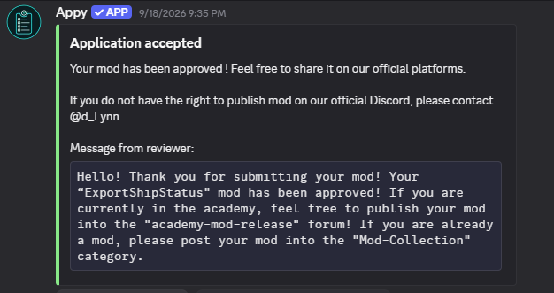

# ExportShipStatus

**《战舰世界》本船遥测模组（仅模组 + 安装程序）**

对局中把**你自己舰船**的血量、起火/进水状态与受伤事件实时写入 JSON Lines 文件，
供同机程序读取。基于官方 PnFMods Mods API，纯后台、无游戏内界面。

> 本仓库包含**模组本体**、**安装 / 卸载 / 打包脚本**，以及预构建的 **Aslain 导入包**。
> 配套的极简接收端、VTube Studio / OBS 特效桥和完整设计文档在另一个仓库：
> **https://github.com/Not-ANumber/ExportShipStatus**

> **官方批准 / Officially approved**
>
> ExportShipStatus 已通过官方模组审核。审核回复：
> “Your ‘ExportShipStatus’ mod has been approved!”
>
> 

## 功能

- **血量快照（1 Hz）**：`health` / `max_health` / `hp_pct` / `alive`，含满血哨兵值修正；
- **起火 / 进水状态**：0.25 s 轮询，输出状态变化、**堆数**与**真实剩余秒数**
  （数据源与游戏内 HUD 同一实体层）；
- **受伤事件**：伤害汇总行 + 每发炮弹弹着行（含 `flags` / `killed` / `salvo`）；
- **对局生命周期**：开局截断重建、退出对局清空，文件只保留最近一场；
- **纯文件输出**：沙箱禁用 socket，模组只向 `profile\wows_telemetry.jsonl` 追加写，
  不修改游戏可执行文件或游戏资源。

## 环境

- Windows；
- 《战舰世界》PC 版（Steam / Wargaming Game Center 均可）；
- 模组运行在游戏自带的 Python 2 沙箱里，**不需要**单独安装 Python。

## 安装

```bat
install.bat
:: 或显式指定游戏根目录
install.bat "D:\Games\World_of_Warships"
```

安装脚本会：

1. 探测游戏路径（注册表 → Steam 多库目录 → 常见路径），多个安装时给出菜单；
2. 定位**最新**的 `bin\<版本>` 目录（游戏更新会新建版本目录）；
3. 检查 `res_mods` 写入权限，必要时提示以管理员身份运行；
4. 清理旧的模组副本后安装到
   `bin\<版本>\res_mods\PnFMods\ExportShipStatus`；
5. 确保 `res_mods\PnFModsLoader.py` 存在（0 字节加载开关）。

安装完成后**重启游戏客户端**。

验证安装：打开 `<游戏根>\profile\python.log`，搜索

```text
[ExportShipStatus] Created instance
```

> **每次游戏大更新后重跑 `install.bat`**。更新会新建 `bin\<新版本>` 目录，且新目录的
> `res_mods` 是空的；缺少 `PnFModsLoader.py` 时所有 PnFMods 模组都不会被加载。

## 通过 Aslain 安装（可选）

如果你已经在用 Aslain 的《战舰世界》Modpack / Mod Manager，可以直接使用仓库根目录的
[`ExportShipStatus-aslain.zip`](ExportShipStatus-aslain.zip)，不必再运行 `install.bat`。

包内结构（已按 Aslain 自定义 mod 规则打好）：

```text
res_mods/
├─ PnFModsLoader.py                  （0 字节加载开关）
└─ PnFMods/ExportShipStatus/
   ├─ Main.py
   └─ core.py
```

两种用法：

- **新版 Aslain's WoWs Mod Manager**：把 zip 放进 `<游戏根>\Aslain_custom_mods\`，
  或在应用里 **Settings → Custom mods → Add mods...** 导入，然后 **Install / Apply**；
- **经典 Aslain Modpack Installer**：把 zip 放进 `<游戏根>\Aslain_Modpack\Custom_mods\`，
  正常运行安装器。

两套产品都会在最后把它解压到 `bin\<当前 build>\res_mods\`；Manager 在下一次 Apply 时
自动重新应用，经典安装器在每次运行时重新应用。包内不带版本号目录，因此同时兼容两套。
完整的格式规则、路径映射和排错见 [`docs/ASLAIN-IMPORT.md`](docs/ASLAIN-IMPORT.md)。

> 包里的 `PnFModsLoader.py` 是 0 字节加载开关。若你已有非空的第三方加载器，
> 请从 zip 中删除该文件，避免覆盖。

## 使用

开一局（训练房即可）。进入战斗后，模组开始写入：

```text
<游戏根>\profile\wows_telemetry.jsonl
```

文件为 UTF-8/ASCII JSON Lines，一行一条消息，可直接用任何语言读取。
典型快照：

```json
{"type":"snapshot","ts":1757600001000,"bt":1.0,"seq":2,
 "health":97200,"max_health":97200,"hp_pct":100.0,"alive":true,
 "burning":false,"flooding":false,"fires":0,"floods":0,
 "fire_time_left":0,"flood_time_left":0}
```

### 消息类型

公共字段：`type` / `ts`（epoch ms）/ `bt`（对局内单调秒）/ `seq`。

| `type` | 频率 | 主要字段 |
| --- | --- | --- |
| `battle_start` | 每局一次 | `ship_name`、`ship_type`、`player_name` |
| `snapshot` | 1 Hz | `health`、`max_health`、`hp_pct`、`alive`、`burning`、`flooding`、`fires`、`floods`、`fire_time_left`、`flood_time_left`、`fire_duration`、`flood_duration` |
| `status_change` | 状态变化时 | `kind`（`burning`/`flooding`/`alive`）、`state`（`started`/`ended`）、`count` |
| `count_change` | 堆数变化时 | `kind`、`count` |
| `damage_taken` | 受伤时 | `source`（`damages`/`shell`）、`amount`、`is_crit`、`killed`、`flags`、`salvo` |
| `battle_end` | 每局一次 | — |

- `fires` / `floods` 是**堆数**，`fire_time_left` / `flood_time_left` 是**真实剩余秒数**；
- 未起火/未进水时为 `0`；仅“在烧但取不到数”时为 `null`；
- 对局开始时文件截断重建，退出对局后文件清空，因此文件只含最近一场数据。

## 卸载

```bat
uninstall.bat
:: 或显式指定游戏根目录
uninstall.bat "D:\Games\World_of_Warships"
```

脚本只移除最新 `bin\<版本>` 下的模组目录；
`res_mods\PnFModsLoader.py` 是所有 PnFMods 模组共享的加载开关，会保留。

## 自行打包

### 独立安装包

```bat
package.bat
```

生成 `ExportShipStatus-dist.zip`，包含：

```text
install.bat / uninstall.bat
tools\find-game.ps1
src\ExportShipStatus\   （模组本体）
README.md               （本说明）
LICENSE                 （MIT）
docs\images\official-approval.png
```

适合分发给其他玩家；对方解压后双击 `install.bat` 即可。

### Aslain 导入包

```bat
package-aslain.bat
```

生成 `ExportShipStatus-aslain.zip`，结构见上文。脚本使用
`tools\make-aslain-zip.ps1` 写入标准 `/` 路径分隔符，避免 Windows PowerShell 5.1
的 `Compress-Archive` 生成反斜杠条目；仓库中已附带一份可直接使用的预构建 zip。

## 仓库结构

```text
ExportShipStatus-Mod/
├─ src/ExportShipStatus/
│  ├─ Main.py        模组入口：订阅战斗事件
│  └─ core.py        生命周期、快照、状态轮询、伤害事件、JSONL 输出
├─ tools/
│  ├─ find-game.ps1       安装脚本的路径探测与最新 bin 目录定位
│  └─ make-aslain-zip.ps1 Aslain 包的标准 ZIP 打包
├─ docs/
│  ├─ ASLAIN-IMPORT.md    Aslain 自定义 mod 规则与使用说明
│  └─ images/official-approval.png
├─ ExportShipStatus-aslain.zip  预构建的 Aslain 导入包
├─ install.bat           安装
├─ uninstall.bat         卸载
├─ package.bat           生成独立分发 zip
├─ package-aslain.bat    生成 Aslain 导入 zip
└─ .github/workflows/ci.yml
```

## 兼容性与已知限制

- 已在 **15.8.0（build 13187581）** 真机验证：加载、血量、起火/进水、受伤事件全链路；
- 游戏大版本更新后：重跑 `install.bat`；若客户端实体层字段被改动，
  起火/进水的堆数与剩余时间会降级为 `null`，其余字段不受影响；
- `damage_taken` 不提供伤害类型/部位（实测确认当前 API 不可用）。
- `core.py` 保持 Python 2 沙箱兼容，同时可被 Python 3 解析，便于离线检查。

开发检查：

```bash
python -m compileall -q src
```

CI 会在 Windows runner 上执行语法检查，用临时假游戏目录跑一遍
`install.bat` / `uninstall.bat` 的冒烟测试，并校验 Aslain 包结构。

## 合规与免责声明

- 模组只读取并导出**玩家自己舰船**、原版界面可见的信息；
  **不含敌人数据、不做任何自动化输入、不提供瞄准辅助、不修改游戏可执行文件或游戏资源**；
- 安装脚本只向游戏目录的 `res_mods` 写入模组文件，并创建 0 字节的
  `PnFModsLoader.py` 加载开关；遥测文件写在 `profile` 下；
- 非官方批准的游戏模组在 Wargaming 政策下属灰色地带。**使用本项目的风险由使用者自行承担**；
  请勿在禁止第三方模组的比赛/活动中使用；
- 本项目与 Wargaming 无关联。

## License

[MIT](LICENSE)
